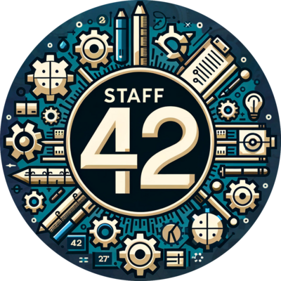

# Staff42 

Staff42 est la communauté francophone des staff engineers. Elle a été créée en 2024 pour promouvoir ces rôles (staff, principal, etc.) et est ouverte à toutes les personnes intéressées par ces rôles.
À Bordeaux, la communauté est animée par Guillaume Amat.

---

## 🔗 Rejoignez la communauté

- **🌐 Site web** : [staff42.org](https://staff42.org)
- **🗣 Meetup** : [meetup.com/staff42](https://www.meetup.com/staff42/)
- **💼 LinkedIn** : [Staff42](https://www.linkedin.com/company/101787260)

<!-- EVENTS:START -->
## 📅 Upcoming Events

## 📆 Past Events
<!-- EVENTS:END -->
